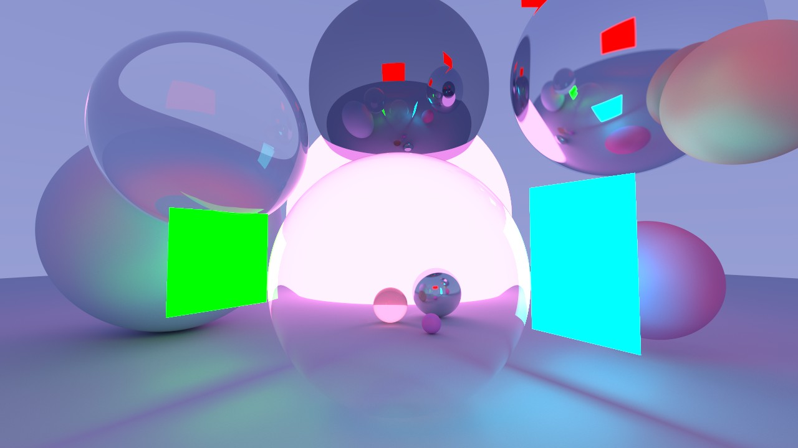
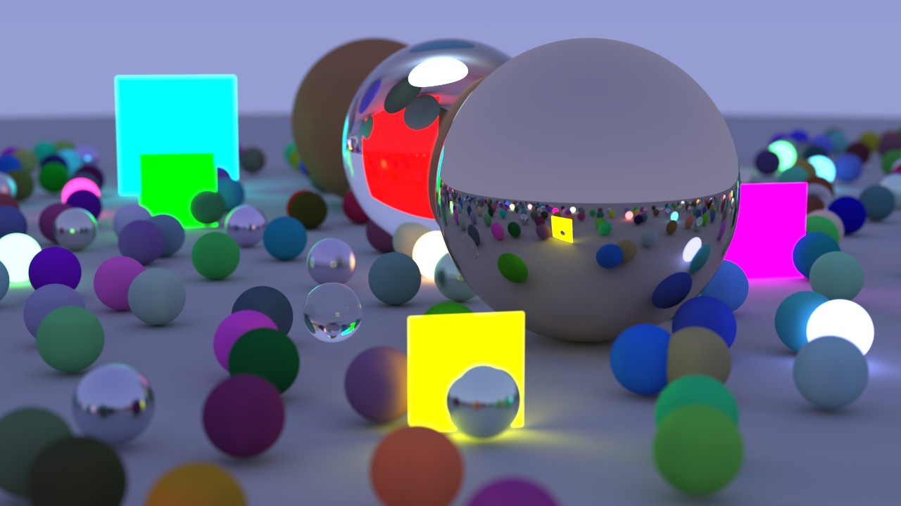
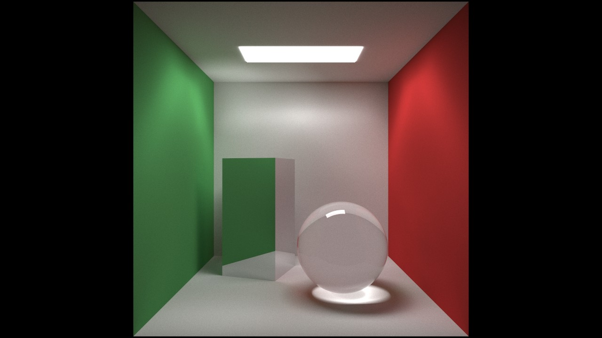

# Unnamed Renderer: 3-Stage Compute Path-Tracer
A hobby path-tracer implemented entirely with DirectX 12 compute shaders. Inspired by Peter Shirley's Ray Tracing in One Weekend.

## Materials
- Lambertian (Diffuse)
- Metallic, with fuzziness
- Dielectric, with a configurable refractive index
- Diffuse Light
- Surface Normal Map (debug view)

## Primitives
- Procedural Spheres
- Procedural Rectangles
- Procedural Triangles

Every primitive stores a Start and End value for its geometry, color and material scalar. These are linearly interpolated across the rendered frames, so objects can move, grow or change color over a render.

## Camera
A positionable thin-lens camera, defined per scene by:
- Look-from and look-at points, plus an up vector
- Vertical field-of-view, in degrees
- Aperture and focus distance, for depth of field

Each scene also defines a two-color sky gradient (top and bottom) that is used for missed rays.

## Rendering Method
Render-Pass 1: Generates an Intersection Map, which is a collection of recorded intersections/misses between the Camera Paths and the Scene Geometry.

Render-Pass 2: Consumes the Intersection Map to generate an Accumulation Frame, which is the total summed Samples for each Pixel.

Render-Pass 3: Consumes the Accumulation Frame to produce the Final Frame, which is then copied into Host RAM for later presentation.

The default settings live at the top of `source/Unnamed Renderer (DX12).cpp`: 1280x720, 4000 samples per pixel submitted 16 at a time, and a maximum recursion depth of 10 bounces.

## Scenes
Each scene is a header-only `build_scene()` implementation, and each one builds as its own executable:

| Target | Scene Header | Description |
| --- | --- | --- |
| `CornellBoxRenderer` | `include/CornellBoxScene.hpp` | The classic Cornell Box, with a glass sphere and a tall metallic box. |
| `RTIOWRenderer` | `include/RTIOWScene.hpp` | The Ray Tracing in One Weekend final scene, under a dusk sky with colored light squares and glowing spheres. |
| `NeonGalleryRenderer` | `include/NeonGalleryScene.hpp` | Glass and mirror spheres around a glowing pink backdrop sphere and neon light panels. |

To add a scene, write a new header that implements `scene_stuff::build_scene()`, add an `add_renderer(...)` line for it in `CMakeLists.txt` with its own compile definition, and add the matching `#elif` include near the top of `source/Unnamed Renderer (DX12).cpp`.

## Building
Requires a 64-bit Windows toolchain and CMake 3.21 or newer. `CMakePresets.json` provides a Visual Studio 2022 x64 configure preset, plus these build presets:
- `debug` and `release`
- `run-cornell-box` and `run-rtiow`, which build and launch those scenes in Release

The bundled `dxcompiler.dll` and `dxil.dll` from `bin/`, along with the shaders, are copied next to each executable after it builds.

## Usage
1. Launch a scene's executable.
2. Left-click to begin rendering.
3. Once the render has finished, left-click again to save the displayed frame as a `.jpg` in `Images/`.

Saved files are named `<Scene>-<SPP>SPP-<Bounces>B-<Width>x<Height>-<Date>-<Counter>-<RenderTime>ms.jpg`.

## Neon Gallery, 20000SPP, 10B, 720p, 119.7s

## RTIOW, 20000SPP, 10B, 720p, 469.5s

## Cornell Box, 20000SPP, 10B, 720p, 119.78s

